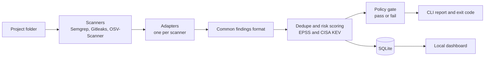

# SPARC

**S**can, **P**rioritize **A**nd **R**esolve risks in **C**ode

A local-first tool that scans a project folder with open-source security scanners, merges the results into one clean list, and tells you which risks to fix first.

> **Status: 🚧 In development (Milestone 0: project setup).**

---

## Why SPARC?

- **AI-written code needs checking.** More developers now write code with AI assistants. That code can contain hidden flaws such as missing input validation, weak authorization checks, and hardcoded secrets.
- **Scanners are noisy.** Running several security scanners produces overlapping results, and teams spend a lot of time sorting through alerts to find the ones that matter.
- **Privacy and simplicity.** Many tools work through connected repositories or CI pipelines. SPARC runs on your own computer against a local folder, so your code never leaves your machine.

## What it does (planned)

1. **Scan:** runs open-source scanners on a folder: Semgrep (code issues), Gitleaks (secrets) and OSV-Scanner (vulnerable dependencies).
2. **Normalize:** converts every scanner's output into one common findings format.
3. **Dedupe and prioritize:** merges duplicate findings and scores risk using severity and exploitability data (EPSS and the CISA KEV catalog).
4. **Gate:** gives a pass or fail verdict from a policy file, with stricter rules for code flagged as AI-assisted. AI detection is a heuristic (commit trailers and config-file signals), not proof.
5. **Report:** prints a summary in the terminal and serves a local web dashboard.

## How it works



## Planned usage

```bash
sparc scan ./my-app    # scan a folder and print the verdict
sparc ui               # open the local dashboard
```

*Not implemented yet.*

## Tech stack

- TypeScript on Node.js
- SQLite for local storage
- Open-source scanners run as subprocesses
- A lightweight local web dashboard
- Docker for easy scanner setup

## Roadmap

- [ ] **0.** Repository, tooling and a deliberately vulnerable test app
- [ ] **1.** Run each scanner by hand and study its raw output
- [ ] **2.** Define the common findings format and write the first adapter
- [ ] **3.** Add the remaining adapters, with tests
- [ ] **4.** Deduplication and risk scoring
- [ ] **5.** Policy file, pass/fail gate and AI-assisted code rules
- [ ] **6.** SQLite storage and the CLI
- [ ] **7.** Local API and dashboard
- [ ] **8.** Evaluation, threat model and write-up

## Design principles

- **Local first.** Code stays on your machine, and the tool works offline once the exploitability data is cached.
- **Orchestrate, don't rebuild.** SPARC combines proven open-source scanners instead of writing its own.
- **Honest metrics.** Results will be measured on a small set of seeded flaws and reported as they are, with no inflated claims.
- **Small and testable.** Every adapter and scoring rule has automated tests.

## Non-goals

SPARC does not aim to include its own scanners, cloud security checks, automatic code fixes, runtime protection or multi-user features.

## Evaluation (planned)

SPARC will be tested on deliberately vulnerable code, including AI-generated samples with typical flaws. The results (how many seeded issues were caught, and how much noise was removed compared with the raw scanner output) will be published here. This is a small lab experiment, not an industry benchmark.

## Disclaimer

- Test applications in this repository are **intentionally vulnerable. Never deploy them.**
- SPARC is a learning project and does not replace commercial or enterprise security tools.
- It is not affiliated with any scanner vendor.

## License

MIT (to be confirmed).

## Author

Hrishab Hosmani
